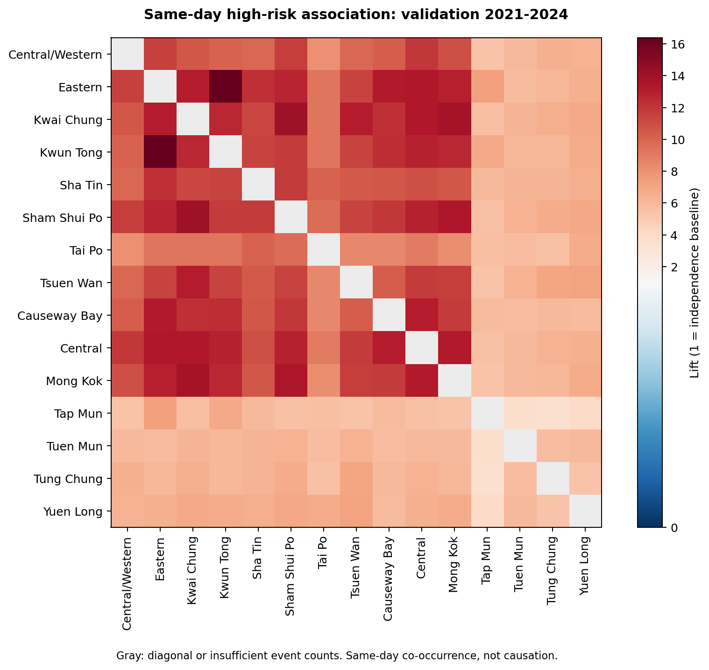

# 关联规则挖掘：监测站同日高风险共现

## 做了什么

使用2014—2024年固定15站，每天是一条事务。某站当天至少1个有效小时AQHI≥7，就记为该站发生高风险事件。剔除替代与缺失记录；15站当天均有至少20个有效小时才保留该日。合格但没有任何高风险事件的日期也保留，不将缺失当成0。规则箭头表示同日条件频率，不表示先后顺序、传播方向或因果。

完整日历有4018天，保留1837天（45.72%），排除2181天。发现期2014—2020年保留1063天，验证期2021—2024年保留774天；其中无任何事件的日期分别为788和594天。各年份/季节的筛选比例见association_coverage_summary.csv。共同覆盖要求排除了超过一半日期，因此结果仅代表保留日期，不能直接推广到全部日历日。

## 方法与验证

使用限定到两项集的Apriori：先找频繁单站，再将频繁单站连接成候选站对并筛选频繁二项集，最后生成单站→单站规则。仅依赖现有NumPy/pandas，没有增加安装依赖。

支持度=两站共同事件天数/合格天数；置信度=共同事件天数/前项事件天数；提升度=置信度/后项本身的事件比例。提升度1为独立基线，A→B与B→A的置信度可能不同，但提升度相同。后项基准频率较低也可能使提升度较高，必须结合支持度、置信度与事件数解读。

发现期筛选门槛：支持度≥1%、置信度≥60%、提升度≥1.2、前项至少50天、共同事件至少30天。候选完全由2014—2020年确定；2021—2024年不重新选规则。验证期沿用比例门槛，事件数门槛为前项至少20天、共同至少10天；“通过”仅表示达到这些分析门槛，不等于显著性检验。

共筛出189条候选规则，验证期有138条达到全部验证门槛，189条提升度大于1。这些是有向规则，同一站对的两个方向可各计一条，并非189个独立站对。另分别在发现期与验证期各做200次月份分块重抽样，并按季节、至少3个高风险小时、完整24有效小时和排除2023年8月进行检查；所有检查沿用固定候选，不根据验证结果改阈值。

考虑共同15站覆盖筛选损失较多，额外对固定候选采用“每对站各自均有20有效小时”的日期重算；该敏感性检查中，验证期142条达到门槛。各规则分母不同，因此这项检查不用于重新挖掘或跨规则比较支持度。

## 发现期排序前10条规则

下表按发现期置信度、提升度、支持度排序，未按验证表现重新挑选。数值为真实计算结果；完整表含共同事件数、后项基准频率、区间和聚类标签。

| 规则 | 发现期支持度 | 发现期置信度 | 发现期提升度 | 验证期共同天数 | 验证期置信度 | 验证期提升度 | 达到验证门槛 |
| --- | ---: | ---: | ---: | ---: | ---: | ---: | --- |
| Sham Shui Po → Mong Kok | 10.44% | 100.00% | 7.76 | 40 | 86.96% | 13.46 | 是 |
| Kwun Tong → Mong Kok | 9.78% | 97.20% | 7.54 | 30 | 81.08% | 12.55 | 是 |
| Eastern → Central | 8.28% | 95.65% | 6.73 | 30 | 81.08% | 13.35 | 是 |
| Central/Western → Central | 10.25% | 95.61% | 6.73 | 42 | 72.41% | 11.93 | 是 |
| Sham Shui Po → Central | 9.88% | 94.59% | 6.66 | 36 | 78.26% | 12.89 | 是 |
| Eastern → Causeway Bay | 8.18% | 94.57% | 5.84 | 34 | 91.89% | 13.17 | 是 |
| Sha Tin → Mong Kok | 9.50% | 94.39% | 7.32 | 36 | 67.92% | 10.51 | 是 |
| Kwun Tong → Central | 9.50% | 94.39% | 6.64 | 29 | 78.38% | 12.91 | 是 |
| Sha Tin → Central | 9.50% | 94.39% | 6.64 | 35 | 66.04% | 10.88 | 是 |
| Kwun Tong → Causeway Bay | 9.50% | 94.39% | 5.83 | 32 | 86.49% | 12.40 | 是 |

## 如何读图与结果文件

热图只使用2021—2024年验证数据，红色表示提升度高于1，蓝色低于1；灰色为对角线或事件数不足的站对，不表示关联为0。图中包含全部满足计数门槛的站对，未只展示筛选成功的规则。

- association_rules.csv：发现期冻结规则，含验证结果及月份块区间。
- association_all_pairs.csv：全部210个有向站对的发现/验证/合并统计。
- association_daily_transactions.csv：合格日期的0/1事务矩阵。
- association_station_daily.csv、association_date_coverage.csv：站日计数、未知标记和日期筛选。
- association_frequent_itemsets.csv：发现期频繁一项集与二项集。
- association_rule_seasonal.csv、association_sensitivity.csv：季节及事件/覆盖定义对照。

连续高风险日可能来自同一过程，因此采用月份块评估不确定性。置信度不是预测准确率；高提升度也可能受季节、气象及筛选日期影响。与聚类的关系用于补充描述，不能作为完全独立验证。

方法参考：[Apriori](https://rasbt.github.io/mlxtend/user_guide/frequent_patterns/apriori/)；[关联规则指标](https://rasbt.github.io/mlxtend/user_guide/frequent_patterns/association_rules/)。