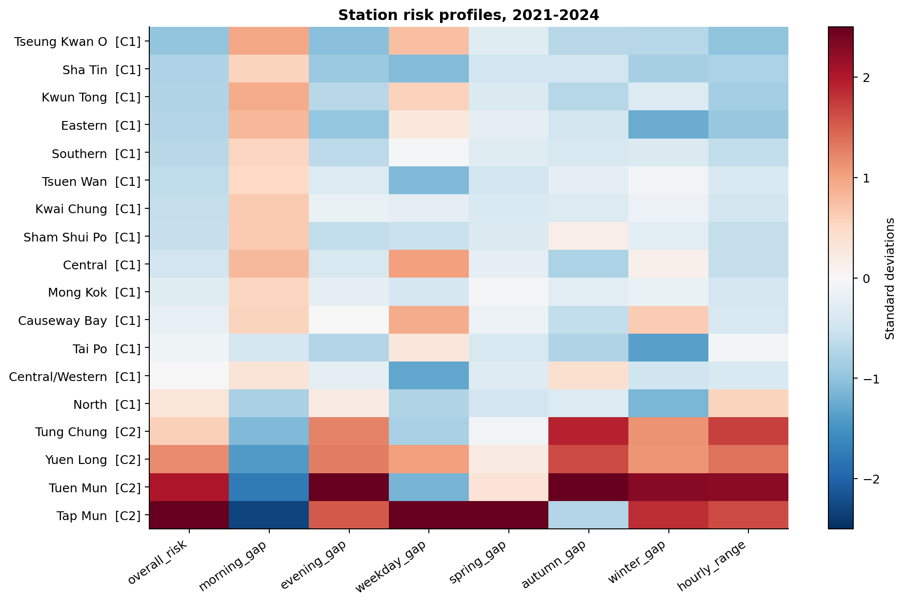
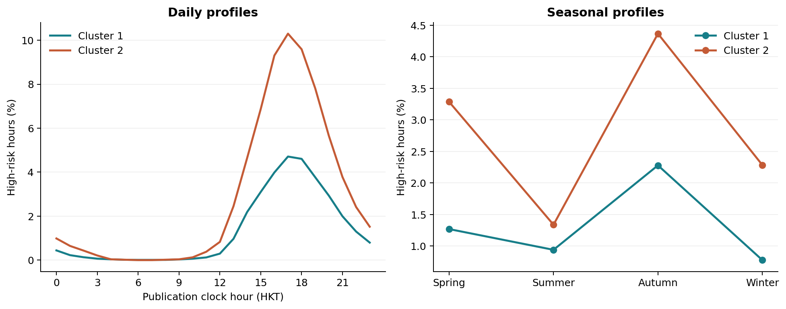
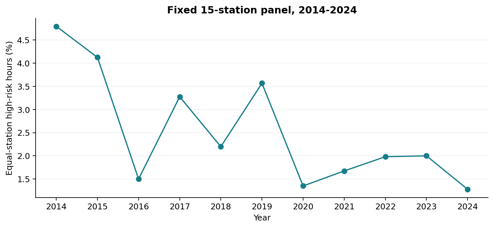

## 研究问题与分析样本

香港高AQHI的时间与空间分布模式

工作包括监测站特征工程、聚类、结果解释和稳健性分析。

### 研究问题

哪些监测站具有相似的高风险AQHI模式？这些模式如何随小时、平日与周末以及季节发生变化？我们利用时间变化特征描述站点之间的相似性，将各张图表组织为同一研究问题下的分析。

### 数据与可比时段

处理后的数据包含1,838,616行“监测站×小时”记录，来自151个源文件；源日期范围为2013年12月至2026年6月。将军澳较晚有有效数据，南区和北区在2020年才有有效记录，25年3月据官网所示，AQHI的算法有所更新。2021—2024是这些站均已存在，且在算法更新前的完整年份。这个版本采用全部18个监测站在2021—2024年完整年份的数据。长期变化的背景分析则采用2014—2024年固定15个早期监测站的面板数据。

| 主分析样本核算 | 站点小时数 |
| --- | --- |
| 根据完整日历计算的期望记录数 | 631,152 |
| 实际存在的记录行数 | 628,128 |
| 整行缺失的记录数 | 3,024 |
| 已存在记录中AQHI缺失的行数 | 9,990 |
| 被排除的非缺失替代记录数 | 15,971 |
| 实际纳入分析的记录数 | 602,167 |
| 纳入分析的高风险记录数 | 9,878 |
| 分析覆盖率 | 95.41% |

### 指标与数据处理口径

高风险定义为AQHI达到7及以上，包括“10+”。主分析样本排除缺失值及标记为替代数据的记录。“10+”保留为单独的“严重”（Serious）风险类别。覆盖率以完整日历为基准计算，包含整行记录不存在的小时。

交付数据将Hour=01编码为00:00。我们保留该原始字段，另以“源日期加源小时数”作为分析时间戳，因此Hour=24对应次日午夜。这是根据官方“公布时间”定义[1]明确采用的解释，并不表示已经通过外部数据逐条核对时间戳。所有日历字段均按同一分析时间重新生成，同时另行检验交付数据原有时间映射的影响。本文的平日指周一至周五，未单独识别公众假期。

## 特征工程与模型选择

聚类单位是监测站，因此有18个样本，而不是184万个相互独立的样本。小时观测用于估计各站特征。经纬度和站点类型标签不作为聚类输入。

| 八个特征 | 定义 |
| --- | --- |
| 总体风险 | 高风险小时数÷有效小时数 |
| 早峰差异 | 07—09时的风险比例减去10—16时的风险比例 |
| 晚峰差异 | 17—19时的风险比例减去10—16时的风险比例 |
| 平日差异 | 同一月份内配对计算的“平日减周末”风险比例差的均值 |
| 春季差异 | 3—5月风险比例减去6—8月风险比例 |
| 秋季差异 | 9—11月风险比例减去6—8月风险比例 |
| 冬季差异 | 12—2月风险比例减去6—8月风险比例 |
| 日内极差 | 24个钟点风险比例的最大值减去最小值 |

站点纳入标准为总体分析覆盖率至少90%，且每个必要特征分组及每个钟点的覆盖率至少80%。全部18站均通过。平日与周末的配对比较要求同一站点、同一月份中的两类日期均达到至少85%的覆盖率。其他主要风险比例按有效小时数加权计算。每个特征在站点之间逐列标准化，并保存标准化参数。

K-means采用固定随机种子42，并进行100次初始化。比较K=2、3、4时，轮廓系数分别为0.609、0.606、0.289。按照事先声明的“轮廓系数最高”规则选择K=2，两组分别包含14站和4站。K=3的评分接近，但会形成一个仅含单个站点的组，因此数据不足以确定唯一正确的自然分组数量。另使用Ward层次聚类进行算法对照。

图1：标准化后的监测站特征。展示标签按总体风险排序。为便于阅读，热图颜色范围限制为正负2.5个标准差；实际建模数值并未截断。

## 站点分组与时间变化模式

较高风险组包括塔门、屯门、东涌和元朗。其余14站构成较低风险组，其中包括全部三个路边监测站。下文组别比例先分别计算各站比例，再对站点等权平均。

| 指标 | 第1组：14站 | 第2组：4站 |
| --- | --- | --- |
| 总体高风险小时比例 | 1.31% | 2.82% |
| 早峰减日间 | -1.49个百分点 | -3.47个百分点 |
| 晚峰减日间 | 2.85个百分点 | 5.74个百分点 |
| 配对后的平日减周末 | 0.06个百分点 | 0.14个百分点 |

两组总体风险比例相差1.51个百分点。塔门的站点比例最高，为3.61%；将军澳最低，为0.93%。

图2：采用所选公布小时映射计算的组别时间曲线，各站等权。左右两个面板使用相同的站点分组。

### 数据模式支持哪些结论

两组均在采用的钟点解释下于17时达到峰值；较高风险组为10.30%，另一组为4.71%。两组季节风险比例也都在秋季最高，分别为4.37%和2.28%。晚峰风险高于日间，早峰则低于日间。因此，这些汇总曲线不支持最初设想的早晚两个对称高峰。

平日差异较小。每个站点的配对“平日减周末”差异，其95%月份分块重抽样百分位区间均包含0。因此，我们不声称存在明确的平日效应；这些区间用于探索性分析，并非独立的验证性检验。

午后出现较高风险的时间模式，与多种可能的气象、光化学或区域输送机制相容。AQHI综合污染物信息，并采用3小时移动平均[2]；仅凭AQHI无法识别具体污染物、交通贡献或因果机制。

## 分组的稳健性与局限

按季节分层的月份分块自助法，在每一个日历月份内，对四个“年份—月份”数据块进行有放回抽样。所有站点使用相同的抽样块，以保留共同事件及月内相关性。共进行200次重抽样，每次重新计算特征、标准化并拟合K-means，K保持为主分析选定的数值。调整兰德指数（ARI）中位数为1.000；85.0%的重抽样完全复现主分组。ARI的百分位范围为0.738—1.000。

| 对照设置 | 站点数 | 相对于主分组的ARI |
| --- | --- | --- |
| 纳入替代记录 | 18 | 1.000 |
| 排除2023年8月 | 18 | 1.000 |
| 使用交付数据的时间映射 | 18 | 1.000 |
| 仅使用2021—2022年 | 18 | 0.750 |
| 仅使用2023—2024年 | 18 | 0.257 |
| 使用Ward层次聚类 | 18 | 1.000 |
| 各特征块等权 | 18 | 1.000 |
| 各月份等权 | 18 | 1.000 |
| 最低特征分组覆盖率提高至90% | 10 | 1.000 |

纳入替代记录、排除2023年8月、使用交付时间映射、改用Ward连接方法、对特征块等权处理，以及对覆盖充分月份的风险比例等权处理时，合并窗口分组均保持不变。严格的90%特征分组覆盖率检查仅保留10站，且四个较高风险站中只保留一个；因此，其ARI为1，对被排除站点只能提供有限的证据。

### 时间稳定性是一个重要限制

在2021—2022年，较高风险组包括屯门、东涌和元朗；在2023—2024年，该组仅有塔门。这两个时期的分组与合并窗口分组的ARI分别为0.750和0.257。因此，四年合并数据中的重抽样稳定性，并不表示站点归属能够跨时期保持不变。主结果描述的是合并窗口，而不是永久性的空间分类。

该自助法以选定的八个特征、K=2、四个已观测年份及站点纳入规则为条件。它不衡量分组数量的不确定性，也不能证明这些数据能够代表未来环境条件。特征之间的相关性及站点样本量较小，也会限制解释范围。用于建立聚类的同一批特征，其组间差异属于描述性结果，不能当作独立验证。

## 长期变化背景与推断范围

为了避免监测网络组成变化的影响，长期面板在所有年份均排除将军澳、南区和北区。剩余15站在每一年具有相同权重。缺失值与替代记录沿用相同处理规则，并同时输出年度风险比例与覆盖率。

图3：2025年AQHI编制更新之前，固定站点面板的年度高风险比例。年度均值用于描述变化；连线不是拟合得到的因果趋势。

固定站点面板的平均比例在2014年为4.79%，2024年为1.28%，两个端点之间下降3.52个百分点。这一过程并非单调变化，中间年份存在明显波动。2023年面板的分析覆盖率为89.28%，反映了已知的文件缺口，以及其他缺失值或替代记录排除的影响。

