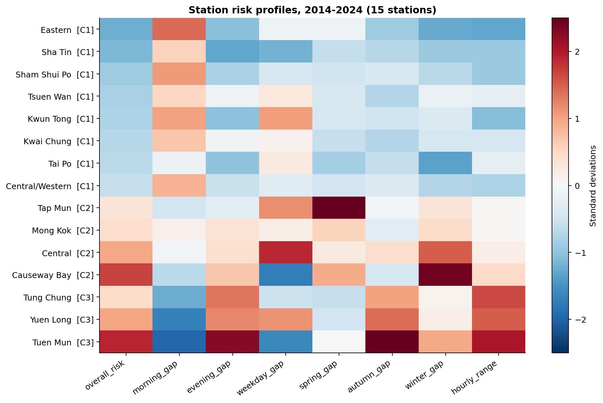
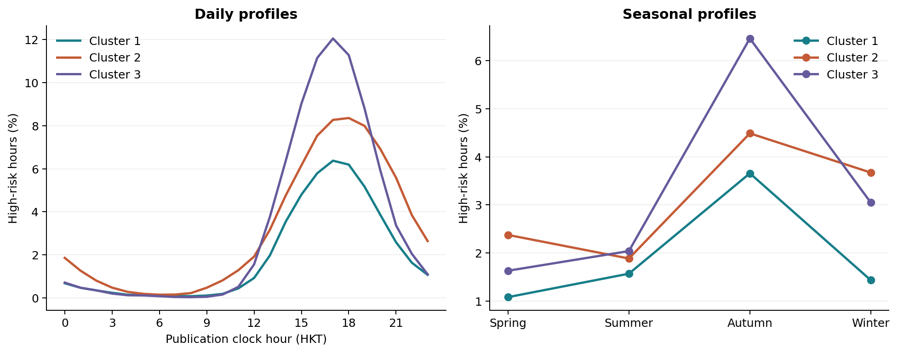
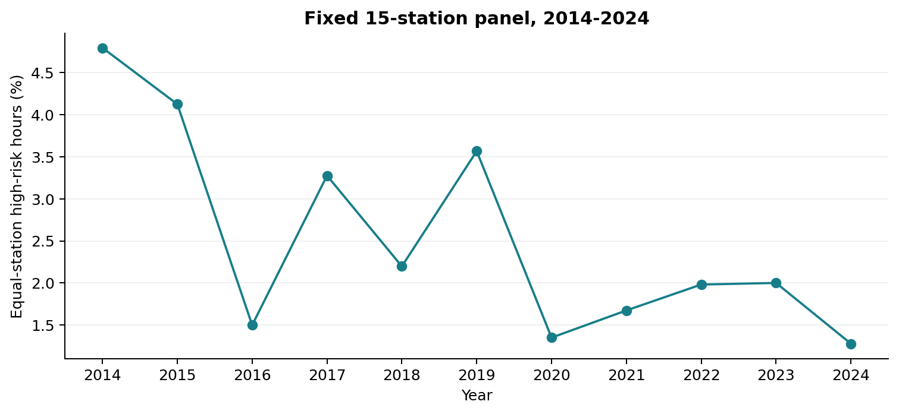

## 研究问题与分析样本

香港高AQHI的时间与空间分布模式
工作包括监测站特征工程、聚类、结果解释和稳健性分析。

### 研究问题

哪些监测站具有相似的高风险AQHI模式？这些模式如何随小时、平日与周末以及季节发生变化？我们利用时间变化特征描述站点之间的相似性，将各张图表组织为同一研究问题下的分析。

## 一、使用的数据

处理后的数据包含1,838,616行“监测站×小时”记录，来自151个源文件；源日期范围为2013年12月至2026年6月。将军澳较晚有有效数据，南区和北区这三个监测站在2020年才有有效记录，25年3月据官网所示，AQHI的算法有所更新。所以这个版本采用15个监测站在2014—2024年完整年份的数据。
每站期望96,432小时，15站共1,446,480个站点小时；存在1,443,960行，整行缺失2,520行；存在行中有12,663条AQHI为空，另排除47,700条非缺失替代记录。最终1,383,597条有效记录，覆盖率95.65%，其中34,699条达到高风险。
日期加原始Hour作为分析时间，Hour=24滚动次日00:00，边界处理与前次相同。数据文件和原始字段没有改写。风险分母只用有效值，覆盖率分母用完整日历；缺失不补0。所有15站通过总体90%、所需分组及钟点80%的门槛。

## 二、完成的工作

分析前检查：核对时间、缺失、替代记录和“10+”；使用完整日历计算覆盖率，避免将缺失误当作低风险
特征工程：为每站计算8个特征：总体风险、早峰差异、晚峰差异、平日与周末差异、春/秋/冬相对夏季的差异、日内波动幅度 
聚类分析：标准化特征，比较K=2、3、4的K-means，并用Ward层次聚类对照，最终采用3组描述 
结果验证：完成200次月份分块重抽样，以及替代值、缺失月份、时间映射、特征权重和不同时期等敏感性检查
时间变化分析：生成日内、星期、季节和年度风险图，解释各组差异与长期变化


## 三、特征工程：
| 八个特征 | 定义 |
| --- | --- |
| 总体风险 | 高风险小时数÷有效小时数 |
| 早峰差异 | 07—09时的风险比例减去10—16时的风险比例 |
| 晚峰差异 | 17—19时的风险比例减去10—16时的风险比例 |
| 平日差异 | 同一月份内配对计算的“平日减周末”风险比例差的均值 |
| 春季差异 | 3—5月风险比例减去6—8月风险比例 |
| 秋季差异 | 9—11月风险比例减去6—8月风险比例 |
| 冬季差异 | 12—2月风险比例减去6—8月风险比例 |
| 日内极差 | 24个钟点风险比例的最大值减去最小值 |

## 四、聚类结果
由：
| 分组数K | 轮廓系数 | 各组站点数 |
| --- | --- | --- |
| 2 | 0.430 | 8；7 |
| 3 | 0.439 | 8；4；3 |
| 4 | 0.419 | 8；3；3；1 |
按照“轮廓系数最高”规则选择K=3，得：
| 分组 | 站点 | 平均高风险小时比例 |
| --- | --- | ---: |
| C1 | 中西区、东区、葵涌、观塘、沙田、深水埗、大埔、荃湾 | 1.93% |
| C2 | 铜锣湾、中环、旺角、塔门 | 3.10% |
| C3 | 屯门、东涌、元朗 | 3.27% |

上述比例为各站风险比例的等权平均。C2与C3总体风险接近，主要区别体现在日内和季节模式。


## 五、时间变化模式与稳健性
三组日内峰值集中在**17—18时**，季节平均风险均在**秋季最高**

日内峰值分别为：C1在17时达到6.37%；C2在18时达到8.36%；C3在17时达到12.05%。三个组的季节平均风险比例均在秋季最高。

## 六、时期敏感性与长期变化背景


每个站点在每一年具有相同权重。

固定站点面板的年度平均比例由2014年的4.79%变为2024年的1.28%，期间存在明显波动。

## 七、其他版本，仅供参考

前期也运行过2021—2024年18站版本，因为能够包含所有18个站点，而且规避了25年3月的aqhi算法更新，但是数据量比较小。
聚类得到2组；最终15站长窗口版本得到3组，说明站点模式与所选时期有关。
聚类结果，两组：
较高风险组包括塔门、屯门、东涌和元朗。其余14站构成较低风险组，其中包括全部三个路边监测站。下文组别比例先分别计算各站比例，再对站点等权平均。
| 指标 | 第1组：14站 | 第2组：4站 |
| --- | --- | --- |
| 总体高风险小时比例 | 1.31% | 2.82% |
| 早峰减日间 | -1.49个百分点 | -3.47个百分点 |
| 晚峰减日间 | 2.85个百分点 | 5.74个百分点 |
| 配对后的平日减周末 | 0.06个百分点 | 0.14个百分点 |
/results/figures/feature_heatmap.png>)


## 八、运行方法

建议使用Python 3.12。在本文件所在的advance_analysis目录打开终端，依次运行：

```powershell
python -m pip install -r "2014-2024_15stations/requirements-lock.txt"
python -B -X utf8 "2014-2024_15stations/src/analyze.py"
python -B -X utf8 "2014-2024_15stations/src/validate_outputs.py"
```

主分析会重新生成统计表和7张图，验证脚本会独立重算120个特征并更新检查结果。两步均不依赖串并行实验。

成员2的数据不包含在此个人源码目录内。默认应放在与advance_analysis相邻的`处理后数据/处理后数据`目录，包含`aqhi_long.csv`、`stations.csv`及`长表字段说明.txt`。若实际位置不同，修改各版本`config.json`中的`input_directory`；相对路径以config.json所在目录为基准，与终端当前位置无关。

18站参考版的运行方法见其README。results中的历史并行、版本对照及交付清单文件为此前保留材料，不由当前两个脚本生成，也不参与当前验证；本次未运行或恢复串并行实验。
